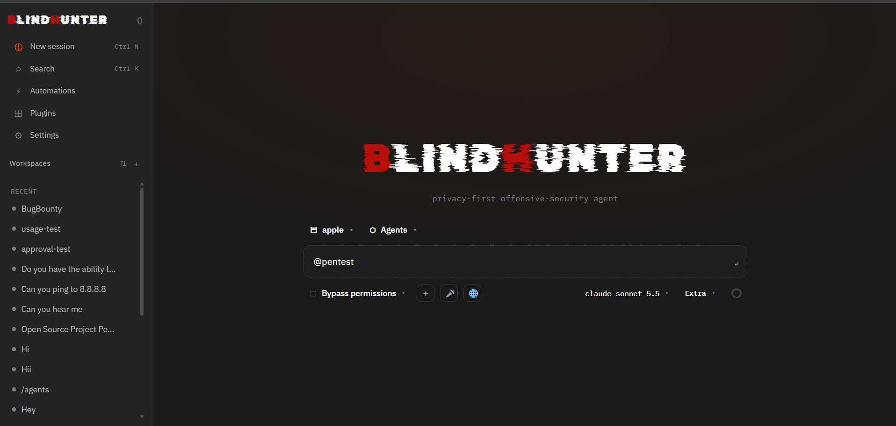

# BlindHunter

**Privacy-first, model-agnostic, open-source AI agent for authorized security testing.**

Self-host it, connect any LLM provider — cloud or local — and keep full control of what
leaves your machine. BlindHunter reads and writes files, runs terminal commands, drives a
real browser, and takes an engagement from recon to a documented finding.



> **Latest release:** [v0.2.0](https://github.com/evertrustai/BlindHunter/releases/latest) ·
> see all [releases](https://github.com/evertrustai/BlindHunter/releases).

---

## What's new in v0.2.0

A big feature release on top of v0.1:

- **Connect with Claude & ChatGPT** — use your Anthropic API key / Claude Pro-Max
  subscription, or sign in to ChatGPT (Codex), alongside any OpenAI-compatible or local model.
- **214 pre-installed security skills** — a bundled library of VAPT / bug-bounty / pentest
  playbooks. Every clone ships them; invoke from the chat with `/<skill>` or let the agent
  pick the right one per scenario.
- **Shared in-app browser** — a real Chromium docked beside the chat as a resizable split
  pane; you and the agent drive the same session live (favicons, security indicator, loading
  bar, click / type / scroll).
- **Integrated terminal** — a real PTY-backed terminal panel (xterm.js) next to the chat.
- **File viewer** — files the agent creates/edits open in a docked viewer with line numbers,
  syntax highlighting and inline image preview for screenshots.
- **Code appearance themes** — 11 light + 19 dark syntax themes (GitHub, Dracula, Nord,
  Catppuccin, Tokyo Night, Monokai …) with a live preview.
- **Telegram bot** — control BlindHunter from your own bot: run tasks, open any session,
  switch model / workspace, and send **voice messages** as prompts (owner-locked pairing).
- **Polished chat** — a clean per-reply layout with the agent's identity, and resilient
  streaming that survives dropped connections during long runs.

See the [full changelog](https://github.com/evertrustai/BlindHunter/releases/tag/v0.2.0).

---

## Highlights

- **Privacy-first** — runs on your machine, keys stay local, **no telemetry**; local models
  (Ollama / LM Studio) are first-class.
- **Model-agnostic** — OpenAI-compatible providers, Anthropic (API key or Claude
  subscription), ChatGPT (Codex), local runtimes, and custom endpoints.
- **Agents & subagents** — `@mention` an agent to take over a session; delegate long tool
  runs to background subagents. Runs continue server-side even if you close the tab.
- **Pentest Mode** — a built-in offensive-security operator preset, plus your own custom agents.
- **Security-skill library** — 214 bundled SKILL.md playbooks, discoverable from the `/` menu.
- **Shared browser + terminal + file viewer** — a full workbench, all docked beside the chat.
- **Telegram control** — drive engagements from your phone, including voice prompts.
- **Self-hosted web UI** — a browser app bound to `127.0.0.1` by default.

## Stack

pnpm monorepo:

- `apps/web` — React + Vite + TypeScript frontend
- `apps/server` — Node + Fastify + TypeScript backend (provider layer, agent loop, tools,
  shared browser, PTY terminal, Telegram, skills engine)
- `packages/*` — shared types and utilities

## Develop

Install dependencies, then start the dev server:

```sh
pnpm install
pnpm dev
```

On Windows PowerShell 5.1, `&&` is not a valid separator — run the two commands on
separate lines (as above), or chain them with:

```powershell
pnpm install; if ($?) { pnpm dev }
```

The web UI runs at http://127.0.0.1:7331. Open **Settings → Models** to connect a provider;
no sign-up or account is required to use BlindHunter itself.

## Security

BlindHunter runs shell commands and drives a browser on your machine. By design:

- The server binds to **`127.0.0.1`** and is hardened with a **Host allowlist** and
  **loopback-only CORS** (DNS-rebinding guard) plus a CSRF guard on mutating requests.
- Credentials (API keys, OAuth tokens, the Telegram bot token) are stored **owner-only
  (`0600`)** under `~/.blindhunter`, are **never returned to the client** (only presence
  flags) and are not logged.
- **No telemetry** — nothing about your sessions or targets leaves your machine except the
  model requests you configure.

**Do not expose it to a network without putting your own authentication in front of it.**
Use it only against assets you are **authorized** to test.

## License

MIT © [evertrustai](https://github.com/evertrustai) ·
[portfolio](https://evertrustai.github.io/portfolio/) · contact: evertrustai@gmail.com
